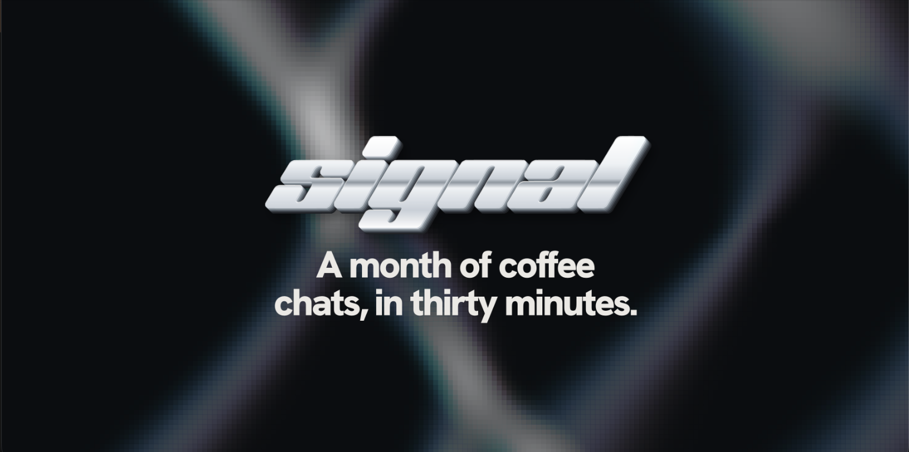

<p align="center">
  
</p>

<p align="center">
  <a href="https://signal-1-three.vercel.app"></a>
  &nbsp;
  <a href="docs/architecture/README.md"></a>
</p>

<p align="center">
  <sub><b>BUILT WITH</b></sub><br>
  
  
  
  
  
  
  
  
  
  
  
</p>

<p align="center">
  <sub><b>CONNECTS TO</b></sub><br>
  
  
  
  
  
  
</p>

---

Signal gives every founder an agent that takes their first coffee chats for them. Your agent meets the other person's agent and decides whether the hour is worth it. You get a yes or a no, and the yeses get booked.

<table align="center">
  <tr>
    <td align="center"><h3>48</h3>coffee chats on the calendar</td>
    <td align="center"><h3>21 min</h3>for the agents to take them all</td>
    <td align="center"><h3>6</h3>meetings worth having</td>
    <td align="center"><h3>32 h</h3>given back to the founder</td>
  </tr>
</table>

<p align="center"><sub>From our demo month: 37 hours of coffee chats, handled in 21 minutes.</sub></p>

## How it works

| | Step | What happens |
| :-: | --- | --- |
| 1 | **Connect your world** | Connect LinkedIn, Gmail and Google Calendar through Composio. |
| 2 | **Define a good signal** | Answer four questions: what you're after, who you want to meet, who isn't a fit, and what your agent may share. |
| 3 | **Save it to memory** | Your profile, your answers and your connected context go into KeewanoDB, which is both the database and the agent's memory. |
| 4 | **Hand it to your agent** | For each chat on your calendar, your agent recalls your context and meets the other person's agent. The agents exchange intros, then your agent asks up to three questions. With Dial, every turn travels as a real message between two numbers. Every turn is logged. |
| 5 | **Get a yes or a no** | Jev reads the logged conversation against your criteria and decides meet or skip. |
| 6 | **Book the meets** | The agents agree on a time, and the meeting goes on your Google Calendar. |

> [!TIP]
> See the [architecture doc](docs/architecture/README.md) for the full design.

## Tech stack

| Layer | Technology |
| --- | --- |
| Frontend | React 19, Vite, three.js, motion |
| Signal agent | Muse Glimmer 30B on Fireworks |
| Meet-or-skip decision | Jev (`typesafe/jev-router`) on OpenRouter |
| Connectors | Composio |
| Database and agent memory | KeewanoDB |
| Agent-to-agent messages | Dial |

## Run it

```sh
npm install
cp .env.example .env.local   # add the keys you have
npm run dev                  # http://127.0.0.1:5173
```

Every service is optional. Each one turns on when its keys are in `.env.local`. With no keys, the app plays the scripted demo month.

| Service | Keys | Without it |
| --- | --- | --- |
| Fireworks | `FIREWORKS_API_KEY`, `FIREWORKS_MODEL` | The scripted demo plays instead of live meetings |
| OpenRouter | `OPENROUTER_API_KEY` | Muse makes the meet-or-skip decision instead of Jev |
| Composio | `COMPOSIO_API_KEY` | Connectors are simulated, and the chats come from the demo month |
| KeewanoDB | `KEEWANO_API_KEY`, `KEEWANO_PAT`, `KEEWANO_EMAIL`, `KEEWANO_PROJECT_ID` | Memory and turns stay in the local store (`.signal/`) |
| Dial | `DIAL_API_KEY`, `DIAL_NUMBER_ID`, `DIAL_COUNTERPART_NUMBER_ID` | The agents talk in-process |

> [!NOTE]
> Fireworks no longer offers Muse Glimmer 30B as a serverless model. Deploy it on demand, then set `FIREWORKS_MODEL` to your deployment's model id.

## Scripts

| Command | What it does |
| --- | --- |
| `npm run dev` | Runs the app and the `/api` routes |
| `npm test` | Runs the unit tests |
| `npm run e2e` | Runs the whole meeting pipeline against a local fake of the model endpoints. No keys needed. |
| `npm run typecheck` | Type-checks the app and the server |
| `npm run calendar:seed` | Puts the 48 demo coffee chats on your connected Google Calendar |
| `npm run dial:setup` | Gives the agent a Dial number and points Dial's webhooks at the app |
| `npm run keewano:setup` | Registers Signal's event types with Keewano and backfills six months of past meets |

## Layout

| Path | What it holds |
| --- | --- |
| `src/app/` | The Signal app: onboarding, calendar, live run, results |
| `server/` | The pipeline: memory, meeting room, decision, booking, and the clients for each service |
| `api/` | The HTTP routes, deployed as Vercel Functions |
| `scripts/` | Setup scripts, the e2e test, and the fake model endpoint |

---

<p align="center">
  <a href="https://signal-1-three.vercel.app"><b>signal-1-three.vercel.app</b></a>
</p>
