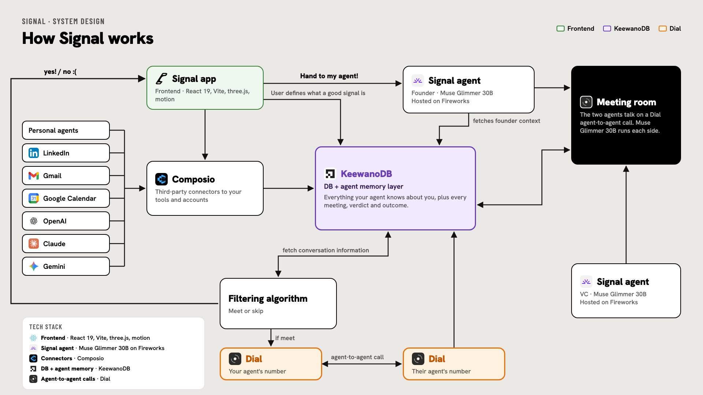
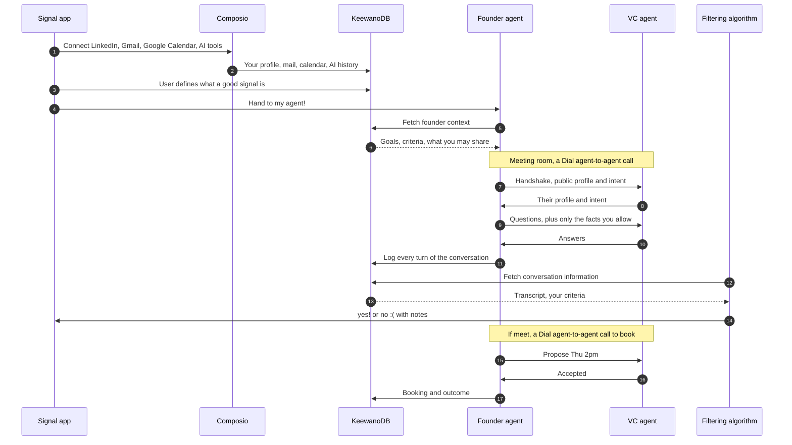

# Signal system design

Signal gives every founder a personal agent that knows them. That agent meets other people's agents, such as a VC's agent, in fast agent-to-agent calls. A filtering algorithm then decides meet or skip. You get "yes!" or "no :(" back in the app, and the good ones get booked. In the demo month, 48 coffee chats (37 hours on the calendar) take 21 minutes of agent time, and 6 are worth meeting. That gives you 32 hours back. These numbers come from `totals` in `src/app/data.ts`.

## Tech stack

| Layer | Technology | What it does for Signal |
| --- | --- | --- |
| Frontend | React 19, Vite, three.js, motion | The Signal app: intake, the live agent run, notes and verdicts. three.js renders the WebGL visuals, and motion runs the animations. |
| Signal agent | Muse Glimmer 30B, hosted on Fireworks | The model behind every agent. It runs both sides of the meeting room conversation. |
| Third-party connectors | Composio | Connects the agent to your accounts and tools, so it learns about you without manual data entry. |
| DB and agent memory | KeewanoDB | The one store for app data and agent memory. It holds your context and every meeting, verdict and outcome. |
| Agent-to-agent calls | Dial | Gives each agent a real number. Agents call each other through Dial. |

## What exists today and what is proposed

| Part | Status |
| --- | --- |
| Signal app: login, LinkedIn step, 4-question intake, calendar of 48 chats, compress animation, live run, results with notes and trace | Built. Frontend only (`src/app/App.tsx`, `LiveRun.tsx`, `Results.tsx`) |
| `Meet`, `checks`, `shared`, `withheld`, `trace`, `verdict`, `notes` data shapes | Built as hardcoded demo data in `src/app/data.ts` |
| Signal agents on Fireworks, Composio connectors, KeewanoDB memory, Dial agent-to-agent turns | Built (`server/`, `api/`). Each service switches on when its key is in `.env.local` (see `.env.example`); without keys the app plays the scripted demo month |
| Filtering algorithm | Built. Jev (`typesafe/jev-router` on OpenRouter) gets your criteria and the logged conversation and makes the meet or skip call (`server/filter.ts`) |
| Proof without keys | `npm run e2e` runs the whole pipeline against a local fake of the model endpoints (`scripts/fake-fireworks.ts`) |

The prototype's `Meet` type is already the output contract of the target system. The backend has to produce those shapes, and the UI does not need to change.

## How it works

1. **You connect your world.** The Signal app connects to Composio. Composio brings in your personal agents, LinkedIn, Gmail, Google Calendar, and your AI tools (OpenAI, Claude, Gemini). Everything lands in KeewanoDB.
2. **You define a good signal.** In the 4-question intake, you say what you're after, who you want to meet, who isn't a fit, and what your agent may share. The app writes this into KeewanoDB as your criteria.
3. **Hand to my agent!** The app hands off to your Signal agent (Muse Glimmer 30B on Fireworks). Before each meeting, the agent fetches your founder context from KeewanoDB.
4. **Agents meet.** Your agent and the other person's agent, such as a VC's, meet in the meeting room on a Dial agent-to-agent call. Every turn of the conversation is logged to KeewanoDB.
5. **Meet or skip.** The filtering algorithm fetches the conversation from KeewanoDB, scores it against your criteria, and sends "yes!" or "no :(" back to the app with notes.
6. **If meet, book it.** Your agent's Dial number calls their agent's Dial number to agree on a time. The result is written back to KeewanoDB, so every booking and outcome becomes part of your agent's memory.

## The meeting room protocol

Every meeting runs the same steps. Each step writes one or more `trace` entries, which the Results view already shows.

1. **Handshake.** Each agent shares a public profile and an intent. If the other side's intent is on your skip list, the meeting ends here. Example: Tom Reyes, a recruiter, gets `Matched, Intent: recruiting, on your skip list`, then `Verdict, Skip, 99% confidence` at 22 seconds.
2. **Ask and share.** Your agent asks the questions you would ask over coffee. It shares only what your intake allows. For Marcus Oyelaran, `shared` holds round size and stage, open-source adoption, and the number of paying pilots. `withheld` holds revenue figures and pilot customer names.
3. **Evaluate.** The filtering algorithm checks the other side against your `criteria` and records the results in `checks`. A failed must-have ends evaluation early. For example, Priya Shah's trace reads `Evaluated, Stage mismatch on a must-have`. The other side's answers are treated as claims, not verified facts.
4. **Verdict.** It returns `meet` or `skip`, with a `reason` and a confidence. Marcus scores 3 of 3, meet, at 96%.
5. **Book.** This happens only on `meet`. The agents agree on a slot over a Dial call (`Scheduled, Proposed Thu 2:00pm, accepted`).

**What the other agent never sees:** your criteria, your skip list, your free-text answer, withheld facts, or your verdict. It only hears what your agent says on the call.

## KeewanoDB: our database and agent memory

KeewanoDB is the one store in the design. It holds app data and agent memory together.

**What goes in:**
- Your profile, mail and calendar from Composio
- Your intake answers and criteria
- Every turn of every meeting room call
- Every verdict, booking and outcome

**What comes out:**
- Founder context for your agent before each meeting
- Conversation information for the filtering algorithm

**Why it fits:**
- **Our data is already ordered events.** A Signal meeting is an ordered list of events tied to one person and one meeting ("Handshake 00:00, Asked 00:05 ... Verdict 00:58"). KeewanoDB stores raw events intact and in order, tied to the entity that produced them.
- **One query path for the agent.** KeewanoDB serves complete sequences to agents as grounded context over MCP, SQL or REST. The agent and the filtering algorithm read from the same place.
- **Lower LLM cost.** Keewano says it compresses long event records into dense context and cuts LLM processing cost by up to 84%. That is Keewano's number, and we have not measured it. It matters because every meeting loads your full context.
- **Learning from past meetings.** Keewano supports similarity queries across sequences. "Past meetings that looked like this one, and how they turned out" is how the filtering algorithm can improve over time.

**The risk.** We have not confirmed that KeewanoDB handles transactional work: logins, edits, deletes, or two agents claiming the same calendar slot. Its docs list Postgres as a source it ingests from, which suggests the usual setup pairs it with an operational database. If the Keewano team says it can't do this, the fallback is a small Postgres for accounts and bookings that streams into KeewanoDB.

## Dial: agent-to-agent calls

Each Signal agent gets a real number from Dial. Dial supports voice calls, SMS, WhatsApp and iMessage through a REST API, MCP server, CLI or SDK (see the [Dial SDK on PyPI](https://pypi.org/project/dial-sdk/0.18.1/)).

**Where Signal uses it:**
- **The meeting room.** Your agent calls the other person's agent, and they run the protocol on the call.
- **Booking.** After a meet verdict, your agent calls their agent again to agree on a time.

**Why it fits.** Agents need a way to reach each other that works across companies and platforms. A phone number is the most universal address there is. Dial is built for agents, needs no telecom setup, and works over MCP, the same way our agent talks to KeewanoDB.

**The tradeoff.** Text exchanges between agents finish in seconds. A voice call takes longer and costs more per minute. The "21 agent-minutes" figure comes from the text-based demo data, so voice calls would raise it. Keeping meeting room calls on Dial's text channels (SMS or WhatsApp) would protect that number.

## Composio: third-party connectors

Composio connects the agent to the accounts where your context already lives: LinkedIn, Gmail, Google Calendar, and your other personal agents and AI tools. It manages auth for each connection, so we don't build or maintain any of those integrations ourselves.

**Open question.** How much history can it pull from ChatGPT, Claude and Gemini? That depends on what each product exposes to third parties, and we should check before the pitch.

## Alternatives we rejected

- **A central matchmaker that reads everyone's full context.** It would be simpler, but Signal would then hold every user's private facts in one place. Each agent speaks only for its own person.
- **One model playing both sides.** It would be cheaper, but it isn't two agents, and nothing would stop it leaking one side's withheld facts to the other.
- **Separate databases for app data and memory.** Postgres plus a vector database means three systems glued together on a hackathon clock. KeewanoDB covers both roles in one.

## Files

| File | What it is |
| --- | --- |
| `signal-sketch.html` and `.png` | The current architecture slide, shown above |
| `signal-stack.html` and `.png` | A simple tech stack slide. It predates the final stack and still shows a generic agent runtime. |
| `signal-architecture.html` and `.png` | An earlier pitch slide. It predates the final stack and shows Dial texting you instead of carrying agent calls. |
| `logos/` | Tool logos used on the slides |
